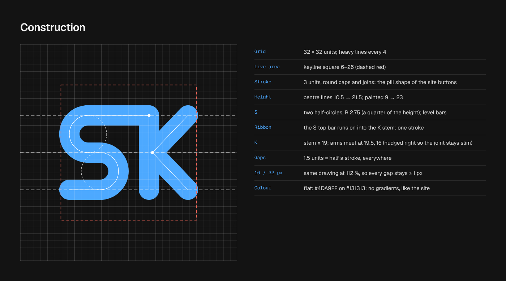
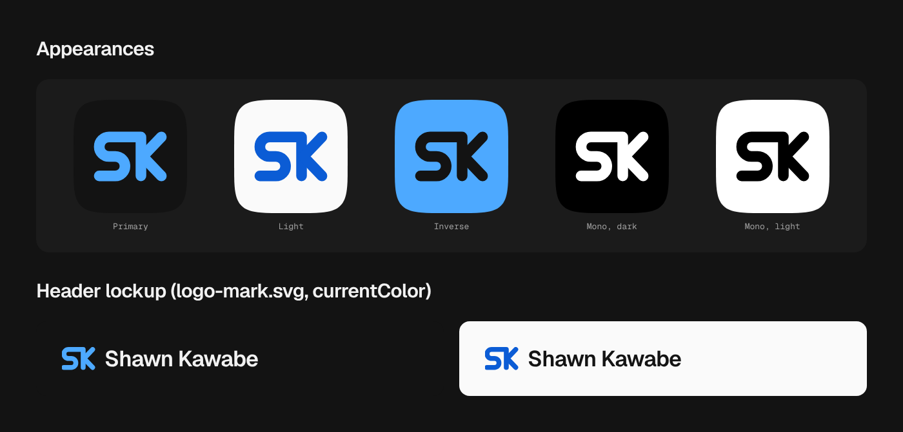
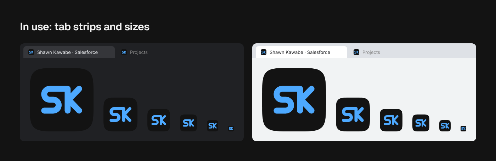

# Site icon: SK Ribbon

The site icon is a single rounded stroke. It draws the S and then runs on into the stem of the K. It is flat brand blue on the dark surface, like the rest of the site: there are no gradients, and blue is the only colour. The round stroke ends echo the pill buttons, and the S curves echo the background rings.

## Rules

- **One drawing.** Every file comes from `scripts/icons.mjs`. Edit the geometry there, run `npm run icons`, then bump `ICON_VERSION` in `src/layouts/BaseLayout.astro`. Never edit the files in `public/` by hand.
- **Grid.** The drawing sits on a 32 × 32 grid, and the mark stays inside the keyline square 6–26.
- **Stroke.** The stroke is 3 units, with round caps and joins.
- **Height.** The centre lines run from 10.5 to 21.5. The S is two half-circles of R 2.75 with level bars.
- **K.** The stem is at x 19. The arms meet at (19.5, 16), nudged right so the joint stays slim.
- **Gaps.** Every gap is 1.5 units, which is half a stroke.
- **Small sizes.** At 16 and 32 px the same drawing is scaled to 112 %, so every gap stays at least 1 px.
- **Colour.** The mark is `accent-1` dark (#4DA9FF) on `surface-0` dark (#131313). The favicon uses this in both colour schemes, because the blue mark carries on light tab strips too.
- **Inline logo.** `src/assets/logo-mark.svg` has no tile and draws in `currentColor`, so it takes the text or accent colour of whatever holds it. The approved lockup is the mark followed by "Shawn Kawabe" in Geist 600. The mark is about 1.5 × the cap height of the wordmark, with a gap of 0.4 × the mark's width.
- **Don't** add gradients, outlines, shadows or a second colour. Don't stretch the mark or redraw it from a font.

## Appearances

| Appearance        | Tile        | Mark        | Use                                    |
| ----------------- | ----------- | ----------- | -------------------------------------- |
| Primary           | #131313     | #4DA9FF     | favicon, app icons, social avatar      |
| Light             | #FAFAFA     | #0B5CD5     | light-theme surfaces, documents        |
| Inverse           | #4DA9FF     | #131313     | stickers, slides, high-attention spots |
| Mono dark / light | #000 / #FFF | #FFF / #000 | print, one-colour uses                 |

## Files

| File                                  | Spec                                                              |
| ------------------------------------- | ----------------------------------------------------------------- |
| `public/favicon.svg`                  | small master on the squircle tile                                 |
| `public/favicon.ico`                  | 16, 32 and 48 px (PNG-in-ICO)                                     |
| `public/apple-touch-icon.png`         | 180 px, full-bleed square, mark at 90 %; iOS applies its own mask |
| `public/icon-192.png`, `icon-512.png` | squircle tile                                                     |
| `public/icon-maskable-512.png`        | full-bleed square, mark at 74 %, inside the maskable safe zone    |
| `public/site.webmanifest`             | name, icons, theme colour #131313                                 |
| `src/assets/logo-mark.svg`            | inline mark, `currentColor`                                       |

